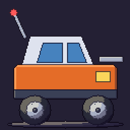
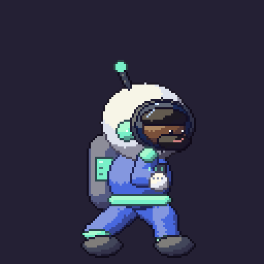
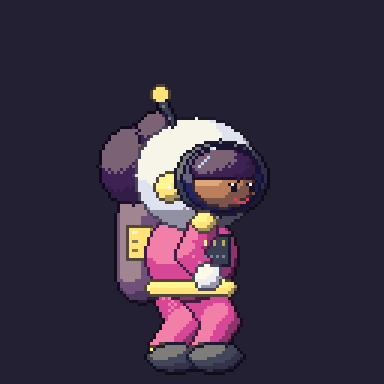
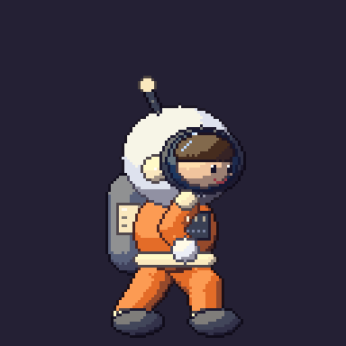
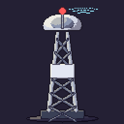

  <svg width="120" height="140" viewBox="0 0 100 110" xmlns="http://www.w3.org/2000/svg">
    <!-- Stem and Leaves -->
    <path d="M50 25 C45 15, 48 5, 52 2 C54 10, 56 18, 55 25 Z" fill="#228b22" stroke="#114411" stroke-width="1.5" />
    <path d="M50 22 C40 18, 25 22, 20 30 C30 32, 42 28, 50 22 Z" fill="#2ecc71" stroke="#114411" stroke-width="1.5" />
    <path d="M50 22 C60 18, 75 22, 80 30 C70 32, 58 28, 50 22 Z" fill="#2ecc71" stroke="#114411" stroke-width="1.5" />
    <path d="M50 24 C45 12, 32 15, 25 22 C33 26, 43 24, 50 24 Z" fill="#27ae60" stroke="#114411" stroke-width="1.5" />
    <path d="M50 24 C55 12, 68 15, 75 22 C67 26, 57 24, 50 24 Z" fill="#27ae60" stroke="#114411" stroke-width="1.5" />
    <!-- Raspberry Body (Cluster of Drupelets) -->
    <path d="M50 30 C30 28, 15 40, 15 60 C15 80, 30 95, 50 100 C70 95, 85 80, 85 60 C85 40, 70 28, 50 30 Z" fill="#d6001c" stroke="#3d0006" stroke-width="3"/>
    <!-- Seeds / Texture Dots -->
    <circle cx="35" cy="45" r="4" fill="#591919"/>
    <circle cx="50" cy="42" r="4.5" fill="#591919"/>
    <circle cx="65" cy="46" r="4" fill="#591919"/>
    <circle cx="27" cy="58" r="4.5" fill="#591919"/>
    <circle cx="43" cy="55" r="5" fill="#591919"/>
    <circle cx="58" cy="56" r="4.5" fill="#591919"/>
    <circle cx="73" cy="57" r="4" fill="#591919"/>
    <circle cx="32" cy="72" r="4.5" fill="#591919"/>
    <circle cx="48" cy="70" r="5" fill="#591919"/>
    <circle cx="63" cy="71" r="4.5" fill="#591919"/>
    <circle cx="38" cy="86" r="4" fill="#591919"/>
    <circle cx="55" cy="85" r="4.5" fill="#591919"/>
  </svg>

# 🍓 Astroberry: The Dangerous Space Adventure (Logic Still Under Construction!) 🚀

Welcome aboard, space adventurer! This is our legendary game where we are still messing around with the code, but it looks so cool from the outside that we just had to show it off before it breaks completely!

🔗 **Try your luck and play it here:** [Astroberry Live](https://astroberry-one.vercel.app/)

---

## 🌌 Quick Look at the Scenes (No Philosophy, Pure Chaos)

  
  

Some stunning space views, a gorgeous alien planet, and fancy-looking buildings with zero structural guarantees.

---

## 🦸‍♂️ Heroes Who Have No Clue Where They're Going

A crew of clueless cosmic explorers surviving purely on good vibes and broken physics:

*   **Kai:** The captain who keeps sprinting into the unknown void.
    *    
*   **Lyra:** The genius staring blankly, wondering who wrote this spaghetti code.
    *    
*   **Nova:** Defying gravity and jumping across dimensions.
    *    
*   **Rex:** The absolute tank destroying everything in his path.
    *    

---

## 🛠 Gear & Gadgets Straight from the Source

<table>
  <tr>
    <td align="center">
       
      <b>Communication Tower (To call home... if they answer)</b>
    </td>
    <td align="center">
       
      <b>The Drill (To dig our own grave)</b>
    </td>
  </tr>
</table>

---

> *⚠️ Important Disclaimer:* If characters start phasing through walls or floating into deep space, don't worry—those aren't bugs, they are **premium features** of the upcoming physics update! 😉