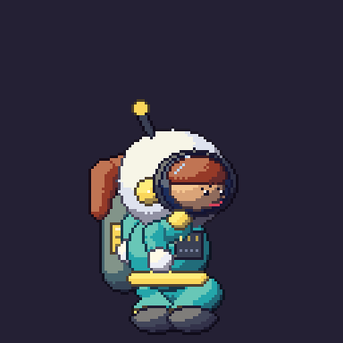
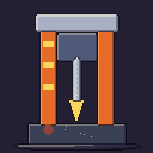

  

Astroberry: The Dangerous Space Adventure (Logic Still Under Construction!) 🚀
Welcome aboard, space adventurer! This is our legendary game where we are still messing around with the code, but it looks so cool from the outside that we just had to show it off before it breaks completely!

🔗 Try your luck and play it here: Astroberry Live

🌌 Interactive 3D Mars Globe

  

Some nice space views, a gorgeous planet, and fancy-looking buildings with absolutely zero guarantee they won't collapse on the characters' heads.

🦸‍♂️ Heroes Who Have No Clue Where They're Going
A crew of clueless aliens and humans drifting through the cosmos, each surviving purely on good vibes and luck:

Kai: The captain who just keeps running without knowing where he's headed.

Lyra: The genius who is staring blankly because she has no idea how this code was written.

Nova: Flying through the chaos and jumping around everywhere.

Rex: The tank destroying everything in his path.

🛠 Some Gear and Gadgets Straight from the Source
<table> <tr> <td align="center">   <b>Communication Tower (To call home... if they answer)</b> </td> <td align="center">   <b>The Drill (To dig our own grave)</b> </td> </tr> </table>
⚠️ Important Disclaimer: If you notice characters flying off into deep space or phasing through walls, these aren't bugs—they are extra features included in the brand-new logic update! 😉

